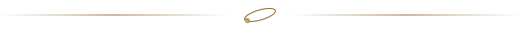

<picture>
  <source media="(prefers-color-scheme: dark)" srcset="assets/hero-dark.svg">
  
</picture>

  <picture>
    <source media="(prefers-color-scheme: dark)" srcset="assets/strip-dark.svg">
    
  </picture>

**Capiamo quando fidarsi dei sensori e distinguiamo un guasto da un'anomalia della pianta.**

[Il progetto](#il-progetto) · [Il problema](#il-problema) · [Come funziona](#come-funziona) · [Dalla correlazione alla causa](#dalla-correlazione-alla-causa) · [Cosa costruiamo](#cosa-costruiamo) · [Cosa otteniamo](#cosa-otteniamo) · [Perché lo spazio](#perché-lo-spazio) · [Team](#team) · [Contatti](#contatti)

  <picture>
    <source media="(prefers-color-scheme: dark)" srcset="assets/divider-dark.svg">
    
  </picture>

## Il progetto

Una serra chiusa e autonoma, sulla Terra come in una base lunare, funziona solo se può fidarsi dei propri dati. **CosmoSPROUT** costruisce il livello diagnostico che le dice quando fidarsi.

  <picture>
    <source media="(prefers-color-scheme: dark)" srcset="assets/divider-dark.svg">
    
  </picture>

## Il problema

Lo stesso valore anomalo può avere cinque cause. Sul segnale si somigliano, eppure ognuna chiede un intervento diverso:

| Causa | Cosa serve |
|---|---|
| Guasto del sensore | Riparare o sostituire la sonda |
| Deriva di taratura | Ricalibrare |
| Transitorio di processo | Niente: si riassorbe da solo |
| Anomalia della pianta | Un intervento agronomico |
| Dato incoerente | Escluderlo dall'analisi |

Un allarme a soglia segnala che un valore è fuori range senza indicarne la causa. Le derive lente, che restano sotto soglia, non le vede proprio.

  <picture>
    <source media="(prefers-color-scheme: dark)" srcset="assets/divider-dark.svg">
    
  </picture>

## Come funziona

Il progetto si regge sull'anomaly detection basata sui residui. Un Digital Twin costruito sui bilanci di massa ed energia calcola in continuo il valore atteso di ogni grandezza. Il sistema lavora sullo scarto fra misura e valore atteso, da cui il modello fisico ha già tolto le variazioni prevedibili come il ciclo di luce, la stagione e i cambi di set point. Quello che resta è il segnale del guasto: così il sistema intercetta anche le derive sotto soglia e si può addestrare con pochi mesi di storico.

<picture>
  <source media="(prefers-color-scheme: dark)" srcset="assets/diagnosi-dark.svg">
  
</picture>

  <picture>
    <source media="(prefers-color-scheme: dark)" srcset="assets/divider-dark.svg">
    
  </picture>

## Dalla correlazione alla causa

Un singolo segnale raramente basta. Uno scostamento che nasce in un sottosistema si manifesta in un altro, con ritardi diversi. Un'occlusione parziale della pompa di ricircolo, per esempio, riduce la portata; poi cala l'ossigeno, sale l'ammoniaca e si sposta il pH. Letti uno per uno, i canali indicano un problema chimico, e una correzione chimica coprirebbe la causa senza risolverla. Letti insieme, il primo scostamento che il modello non sa spiegare è quello della portata, quindi la causa è idraulica.

Il sistema ragiona così su finestre di dati multivariate. Insieme all'allarme restituisce l'ipotesi di causa, la sua probabilità e il tempo utile per intervenire.

  <picture>
    <source media="(prefers-color-scheme: dark)" srcset="assets/divider-dark.svg">
    
  </picture>

## Cosa costruiamo

- **Cockpit**: una vista dell'impianto in tempo reale, con i valori collocati nel punto in cui vengono misurati, le tendenze, gli allarmi e le azioni consigliate. Si usa da postazione fissa, da remoto o da mobile.
- **Digital Twin**: un modello basato sui bilanci di massa ed energia, allineato di continuo ai dati di esercizio. Calcola i valori attesi e permette di simulare scenari what-if.
- **Diagnosi con AI**: rilevazione, isolamento e prognosi delle anomalie, con escalation all'operatore quando l'evidenza non basta.

  <picture>
    <source media="(prefers-color-scheme: dark)" srcset="assets/divider-dark.svg">
    
  </picture>

## Cosa otteniamo

- **Rilevazione**: il sistema segnala l'anomalia anche quando il valore resta dentro la soglia.
- **Isolamento**: per ogni anomalia propone una causa, con una probabilità calibrata. Se l'evidenza non basta, si astiene e passa il caso all'operatore.
- **Canale visuale**: le telecamere guardano la coltura. Se le sonde vedono uno scostamento e la pianta sta bene, il sospetto cade sul sensore.
- **Prognosi**: stima quanto tempo resta prima che una grandezza esca dai limiti e quando conviene ricalibrare ogni sonda.
- **Guasti indotti**: quando lo storico non contiene ancora guasti, li provochiamo noi, in modo controllato e reversibile, per insegnare al sistema a riconoscerli.
- **Sensori virtuali**: se una misura manca, il Digital Twin la ricostruisce dalle altre con un'incertezza dichiarata, e l'impianto continua a lavorare in modalità degradata entro margini noti.
- **Dati di cui fidarsi**: ogni intervallo dei dataset prodotti esce con un indice di attendibilità.
- **Nessuna finestra scoperta**: notti, fine settimana e chiusure smettono di essere ore senza sorveglianza.

  <picture>
    <source media="(prefers-color-scheme: dark)" srcset="assets/divider-dark.svg">
    
  </picture>

## Perché lo spazio

Verso Marte un messaggio impiega fino a 22 minuti ad arrivare e, durante la congiunzione solare, le comunicazioni si interrompono per settimane. Un guasto in una serra a ciclo chiuso va gestito in poche ore, quindi la serra deve saper fare la diagnosi da sola.

Nei sistemi spaziali questa capacità ha un nome preciso, Fault Detection, Isolation and Recovery: rilevare un guasto, localizzarlo e avviare il ripristino. Sulle piattaforme robotiche è prassi consolidata, mentre nelle serre, dove una parte del sistema da diagnosticare è viva, è ancora poco applicata. Nella serra antartica EDEN ISS, analogo terrestre delle serre spaziali, nell'inverno 2019 l'equipaggio dedicava alla serra circa 2,6 ore al giorno.

Sulla Terra questo vuol dire un impianto conducibile da remoto per un intero ciclo colturale, che fa anche da analogo terrestre di una serra per missioni di lunga durata.

  <picture>
    <source media="(prefers-color-scheme: dark)" srcset="assets/divider-dark.svg">
    
  </picture>

## Team

| Nome | Ruolo |
|---|---|
| Giorgia Mannarino | Engineer |
| Giorgia Pontetti | Engineer |
| Simone Saverio Fildi | AI Specialist |

Roma, dal 2026

  <picture>
    <source media="(prefers-color-scheme: dark)" srcset="assets/divider-dark.svg">
    
  </picture>

## Contatti

<a href="https://www.linkedin.com/company/coseritylab/">
  <picture>
    <source media="(prefers-color-scheme: dark)" srcset="assets/linkedin-dark.svg">
    
  </picture>
</a>

  

  <picture>
    <source media="(prefers-color-scheme: dark)" srcset="assets/footer-dark.svg">
    
  </picture>

