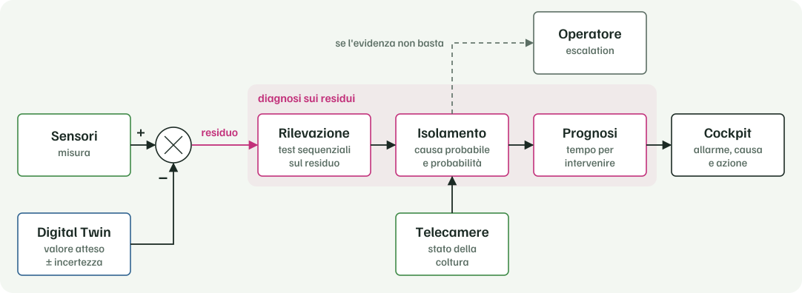

<picture>
  <source media="(prefers-color-scheme: dark)" srcset="assets/hero-dark.svg">
  
</picture>

**Capiamo quando fidarsi dei sensori e distinguiamo un guasto da un'anomalia della pianta.**

[Il progetto](#il-progetto) · [Il problema](#il-problema) · [Come funziona](#come-funziona) · [Cosa otteniamo](#cosa-otteniamo) · [Perché lo spazio](#perché-lo-spazio) · [Team](#team) · [Contatti](#contatti)

---

## Il progetto

Una serra chiusa e autonoma, sulla Terra come in una base lunare, funziona solo se può fidarsi dei propri dati. **CosmoSPROUT** costruisce il livello diagnostico che le dice quando fidarsi. Partiamo da uno dei fitotroni dell'Università Campus Bio-Medico di Roma, nel programma V.I.T.A. Open Innovation.

---

## Il problema

Lo stesso valore anomalo può avere cinque cause. Sul segnale si somigliano, eppure ognuna chiede un intervento diverso:

| Causa | Cosa serve |
|---|---|
| Guasto del sensore | Riparare o sostituire la sonda |
| Deriva di taratura | Ricalibrare |
| Transitorio di processo | Niente: si riassorbe da solo |
| Anomalia della pianta | Un intervento agronomico |
| Dato incoerente | Escluderlo dall'analisi |

Un allarme a soglia segnala che un valore è fuori range senza indicarne la causa. Le derive lente, che restano sotto soglia, non le vede proprio.

---

## Come funziona

Il progetto si regge sull'anomaly detection basata sui residui. Un Digital Twin costruito sui bilanci di massa ed energia calcola in continuo il valore atteso di ogni grandezza. Il sistema lavora sullo scarto fra misura e valore atteso, da cui il modello fisico ha già tolto le variazioni prevedibili come il ciclo di luce, la stagione e i cambi di set point. Quello che resta è il segnale del guasto: così il sistema intercetta anche le derive sotto soglia e si può addestrare con pochi mesi di storico.

<picture>
  <source media="(prefers-color-scheme: dark)" srcset="assets/diagnosi-dark.svg">
  
</picture>

---

## Cosa otteniamo

- **Rilevazione**: il sistema segnala l'anomalia anche quando il valore resta dentro la soglia.
- **Isolamento**: per ogni anomalia propone una causa, con una probabilità calibrata. Se l'evidenza non basta, si astiene e passa il caso all'operatore.
- **Canale visuale**: le telecamere guardano la coltura. Se le sonde vedono uno scostamento e la pianta sta bene, il sospetto cade sul sensore.
- **Prognosi**: stima quanto tempo resta prima che una grandezza esca dai limiti e quando conviene ricalibrare ogni sonda.
- **Guasti indotti**: lo storico dell'impianto non contiene ancora guasti, quindi li provochiamo noi, in modo controllato e reversibile, per insegnare al sistema a riconoscerli.

---

## Perché lo spazio

Verso Marte un messaggio impiega fino a 22 minuti ad arrivare e, durante la congiunzione solare, le comunicazioni si interrompono per settimane. Un guasto in una serra a ciclo chiuso va gestito in poche ore, quindi la serra deve saper fare la diagnosi da sola.

Sul fitotrone del Campus questo vuol dire un impianto conducibile da remoto per un intero ciclo colturale, che fa anche da analogo terrestre di una serra per missioni di lunga durata.

---

## Team

| Nome | Ruolo |
|---|---|
| Giorgia Mannarino | Engineer |
| Giorgia Pontetti | Engineer |
| Simone Saverio Fildi | AI Specialist |

Roma, dal 2026

---

## Contatti

<a href="https://www.linkedin.com/company/coseritylab/">
  <picture>
    <source media="(prefers-color-scheme: dark)" srcset="assets/linkedin-dark.svg">
    
  </picture>
</a>

**CosmoSPROUT**: *dal fitotrone alla base lunare, dati di cui potersi fidare.*

